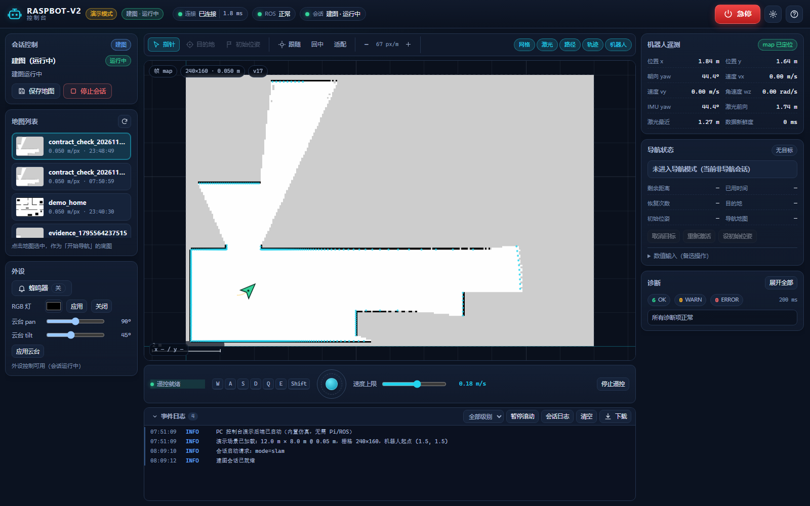
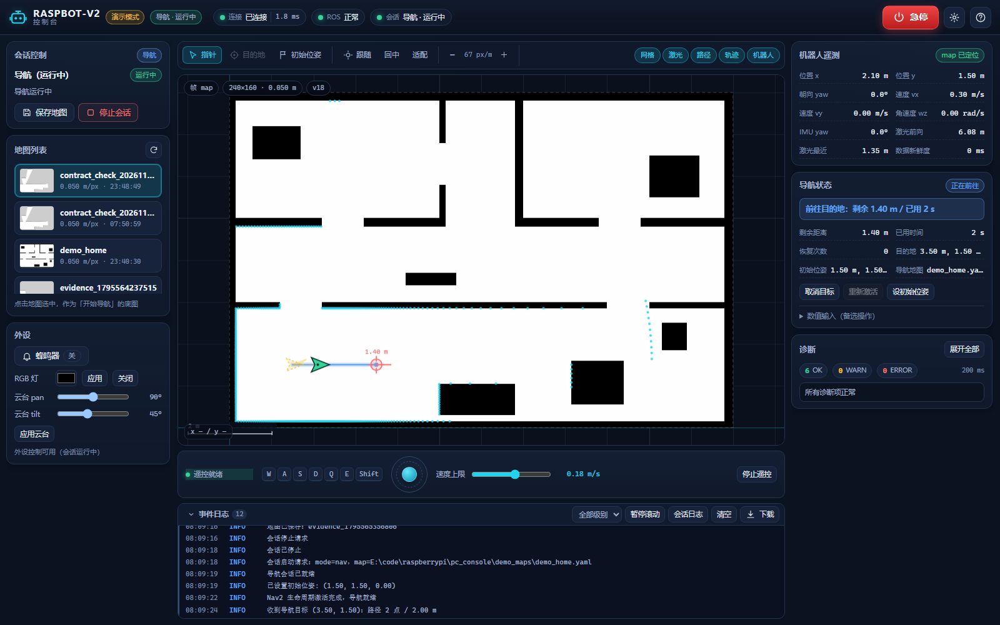

# RASPBOT-V2 智能小车 · ROS 2 全栈（C++ 实现）

基于亚博智能 RASPBOT-V2 麦轮小车的自动驾驶软件栈：树莓派 5 + ROS 2 Lyrical + 激光雷达 + HWT101 IMU + 相机 + **Hailo-8 NPU**，包含底盘驱动、IMU、传感器融合、建图定位、Nav2 导航与 YOLOv8s 视觉推理，8 个 ROS 2 包（另有 PC 上位机网关 `raspbot_console` 第 9 个包，Python/rclpy）、**211 项 gtest 单元测试**、完整台架自测试套件。全部实时运行时节点为 **C++（rclcpp）** 实现（PC 上位机网关除外）；早期 Python 版源码归档于 `legacy_python/`，原 pytest 用例保留在各包 test(s)/ 目录（未改动）。

> PC 端新增「观察 + 控制」上位机控制台（建图启停/保存地图/设目的地/实时位姿/遥控/急停，含无硬件演示模式），见 [PC 上位机控制台](#pc-上位机控制台新增)。

> 文档索引：设计文档见 `docs/`，接口契约见 [`ros2_ws/CONTRACTS.md`](ros2_ws/CONTRACTS.md)，自测试报告见 `docs/自测试报告_2026-11-21.docx`。

---

## 目录

- [硬件组成](#硬件组成)
- [软件架构](#软件架构)
- [PC 上位机控制台（新增）](#pc-上位机控制台新增)
- [快速开始](#快速开始)
- [接口契约（话题/TF）](#接口契约话题tf)
- [测试](#测试)
- [已知限制与坑](#已知限制与坑)
- [仓库结构](#仓库结构)

---

## 硬件组成

| 部件 | 型号/参数 | 接口 |
|---|---|---|
| 主控 | Raspberry Pi 5（Ubuntu 26.04, arm64） | — |
| 底盘 | 亚博 RASPBOT-V2 麦克纳姆轮 ×4 | I2C 0x2B（`/dev/i2c-1`），**无编码器** |
| 扩展板执行器 | 2×舵机（pan 0–180°/tilt ≤110°）、RGB 14 灯、蜂鸣器、超声、四路巡线、红外 | 同 I2C 0x2B |
| IMU | HWT101（串口，100 Hz） | `/dev/raspbot_imu`（udev） |
| 激光雷达 | RPLIDAR（10 Hz，360 线） | `/dev/raspbot_lidar`（udev） |
| 相机 | USB 相机 0c45:64ab（YUYV 640×480@15） | `/dev/raspbot_camera`（udev） |
| NPU | Hailo-8（HailoRT 4.23.0） | PCIe，模型 `/opt/hailo-models/yolov8s_h8.hef` |
| 存储 | NVMe SSD（`/mnt/ssd`，地图/日志） | USB 3.0（UAS） |

## 软件架构

解耦设计（详见设计文档 v2.4）：各工作包独立进程、以话题/TF 契约通信。

```
                    ┌───────────────────────────────┐
   遥测/调试  ←──── │ /diagnostics（safety_node 聚合） │
                    └───────────────────────────────┘
/odom_raw ──► ekf_node ──► /odom + TF: odom→base_link（唯一权威）
  ▲                ▲
  │                └── /imu/data（IMU）
base_node          └── /scan（雷达，经后向 ±165° 滤波）
  ▲
  └── /cmd_vel_safe ◄── cmd_vel_limiter ◄── /cmd_vel（twist_mux 仲裁）
                              ▲
                         /cmd_vel_teleop（遥控）
                         /cmd_vel_nav（Nav2 输出：collision_monitor）
                              ▲
                         controller_server(MPPI) / behavior_server

感知：camera → hailo_node → /detections + /perception/image
建图/导航：slam_toolbox | map_server+amcl → planner/controller → Nav2
```

### 9 个包（8 个 C++/rclcpp ament_cmake + 1 个 Python 网关）

| 包 | 职责 |
|---|---|
| `raspbot_base` | 麦轮运动学/里程计/传感器解码（纯函数库 `raspbot_base_lib`）+ 底盘节点（I2C ioctl、看门狗、诊断） |
| `raspbot_imu` | 双源 IMU（HWT101/ICM-42688/mock），串口断线自动恢复，100 Hz 姿态输出 |
| `raspbot_fusion` | `cmd_vel_limiter`（限幅/急停/IMU 降级/输入超时，纯函数库 `raspbot_fusion_lib`）、`odom_relay`；ekf.yaml 供 robot_localization |
| `raspbot_description` | URDF 与外参、robot_state_publisher（TF 静态外参唯一来源，纯数据包） |
| `raspbot_bringup` | lidar/camera/slam/localization/nav2/perception 全部 launch 与参数（纯数据包） |
| `raspbot_mock` | fake_base / fake_imu / fake_scan（无硬件 SIL 测试） |
| `raspbot_safety` | `/diagnostics` 聚合与安全监视（纯函数库 `raspbot_safety_utils`） |
| `raspbot_perception` | Hailo-8 YOLOv8s 推理节点（HailoRT 原生 C++ API；letterbox/NMS/classes 纯函数库 `raspbot_perception_core`） |
| `raspbot_console` | PC 上位机网关（Python/rclpy）：HTTP/SSE 状态与地图、会话管理、遥控/急停、Nav2 action 与生命周期激活；见 [PC 上位机控制台](#pc-上位机控制台新增) |

---

## PC 上位机控制台（新增）

在 PC 上观察/控制小车的一体化控制台：`pc_console/`（PC 程序，仅 Python 标准库，**无需在 PC 安装 ROS**）＋ `ros2_ws/src/raspbot_console/`（Pi 端 HTTP/SSE 网关，rclpy）。浏览器打开 `http://127.0.0.1:8090/`，PC 程序代理到 Pi 网关 `:8080`；可用 `--demo` 在无硬件时完整演示。

**功能**：实时 2D 地图、机器人位姿/朝向/速度、激光点、Nav2 路径、诊断与日志；一键开始/停止建图与保存地图；选择地图导航 → 地图上拖拽设初始位姿 → 点击地图设目的地 → 查看剩余距离/取消/重试；键盘（WASD/QE）与虚拟摇杆遥控、500 ms 看门狗松手即停；软件急停（解除需二次确认）；蜂鸣器/RGB/云台；**无硬件演示模式**（12×8 m 室内仿真，可完整跑通建图→保存→导航→急停）。

```powershell
# 无硬件演示（推荐首次体验；Windows 也可双击 pc_console\start-demo.bat）
cd pc_console
python main.py --demo

# 真车（Pi 与 PC 同一局域网；也可双击 start.bat，首次在设置里填 Pi 地址）
python main.py --pi 192.168.50.98:8080

# Pi 端首次部署（PC 上执行，需要能 ssh/scp 到 Pi）
pwsh -File tools\console\deploy.ps1
# Pi 上启动网关（二选一）：
ros2 run raspbot_console console_bridge --port 8080
bash ~/tools/console/install_service.sh --start
```

与 `rasbot.service`（systemd bringup）**二选一**：网关托管 bringup，或网关加 `--attach` 附加到外部 systemd 栈；两者同时托管会抢同一个 ROS 图（详见操作手册）。

文档与工具：[设计文档/接口契约](docs/PC上位机_设计文档_v1.md) · [操作手册](docs/PC上位机_操作手册_v1.md) · [验收记录](docs/PC上位机_验收记录_2026-11-24.md) · [部署与验收脚本](tools/console/README.md)。

界面截图（演示模式）：

| 建图中 | 导航中 |
|---|---|
|  |  |

> 当前 Pi 离线：网关的 ROS 运行时部分尚未真机联调；离线验证（PC 程序 64 项 unittest、网关纯逻辑 118 项、Web 19 项 Node 测试、演示模式契约全流程 33 项）全部通过。Pi 上线后按验收记录 §6 执行台架 SIL 与真车 TC-C1~C5。

---

## 快速开始

### 1. 依赖

```bash
# ROS 2 Lyrical（/opt/ros/lyrical）+ 常用导航/传感器包
sudo apt install ros-lyrical-nav2-bringup ros-lyrical-slam-toolbox \
     ros-lyrical-robot-localization ros-lyrical-rplidar-ros \
     ros-lyrical-v4l2-camera ros-lyrical-laser-filters \
     ros-lyrical-twist-mux python3-smbus i2c-tools
# Hailo 运行时（HailoRT 4.23.0，含 hailo_platform Python 绑定）
```

### 2. 构建

```bash
cd ros2_ws
colcon build --symlink-install
source install/setup.bash
```

### 3. 运行

```bash
# 台架/开发：全部 mock（无硬件）
ros2 launch raspbot_bringup bringup.launch.py mode:=none use_mock:=true

# 真硬件基础层（底盘+IMU+雷达+融合+安全）
ros2 launch raspbot_bringup bringup.launch.py mode:=none

# 真硬件 + 建图（slam_toolbox）
ros2 launch raspbot_bringup bringup.launch.py mode:=slam

# 真硬件 + 静态地图导航（需先给初始位姿，见下）
ros2 launch raspbot_bringup bringup.launch.py mode:=nav map:=/mnt/ssd/maps/my_map.yaml

# 感知（相机 + Hailo）
ros2 launch raspbot_bringup bringup.launch.py mode:=none use_camera:=true use_perception:=true
```

**导航模式操作流程**（map_server + amcl）：

```bash
# 1) 发布初始位姿（/initialpose），等 map→base_link TF 出现
ros2 topic pub --once /initialpose geometry_msgs/msg/PoseWithCovarianceStamped \
  "{header: {frame_id: 'map'}, pose: {pose: {position: {x: 0.0, y: 0.0}, orientation: {w: 1.0}}, \
    covariance: [0.25,0,0,0,0,0, 0,0.25,0,0,0,0, 0,0,0,0,0,0, 0,0,0,0,0,0, 0,0,0,0,0,0, 0,0,0,0,0,0.0685]}}"
# 2) 激活 Nav2 生命周期节点（本栈不 autostart，顺序敏感）
bash .dsh/selftest/activate_nav2.sh
# 3) 发目标
ros2 action send_goal /navigate_to_pose nav2_msgs/action/NavigateToPose \
  "{pose: {header: {frame_id: 'map'}, pose: {position: {x: 1.5, y: 0.0}, orientation: {w: 1.0}}}}"
```

遥控（twist_mux 最高优先级输入）：

```bash
ros2 run teleop_twist_keyboard teleop_twist_keyboard --ros-args -r cmd_vel:=/cmd_vel_teleop
```

## 接口契约（话题/TF）

完整定义见 [`ros2_ws/CONTRACTS.md`](ros2_ws/CONTRACTS.md)。核心：

| 话题 | 类型 | 方向/说明 |
|---|---|---|
| `/cmd_vel` | `geometry_msgs/Twist` | twist_mux 仲裁输出（遥控 > Nav2） |
| `/cmd_vel_teleop` | `geometry_msgs/Twist` | 遥控输入（最高优先级） |
| `/cmd_vel_nav` | `geometry_msgs/Twist` | Nav2 输出（collision_monitor 之后） |
| `/cmd_vel_safe` | `geometry_msgs/Twist` | limiter 输出 → 底盘（唯一执行入口） |
| `/estop` | `std_msgs/Bool`（latched） | 软件急停，锁存至 false |
| `/odom_raw` | `nav_msgs/Odometry` | 底盘开环里程计（无 TF） |
| `/odom` | `nav_msgs/Odometry` | EKF 融合输出（30 Hz） |
| `/imu/data` | `sensor_msgs/Imu` | 100 Hz |
| `/scan` | `sensor_msgs/LaserScan` | 10 Hz，过滤后 ±165° |
| `/detections` | `vision_msgs/Detection2DArray` | Hailo 检测结果 |
| `/perception/image` | `sensor_msgs/Image` | 标注图 |
| `/diagnostics` | `diagnostic_msgs/DiagnosticArray` | safety_node 聚合（1 Hz） |

**TF 唯一权威**：`odom→base_link` 由 EKF 发布；`base_link→{laser,imu_link,camera_link,ultrasonic}` 由 robot_state_publisher 发布；`map→odom` 由 amcl/slam_toolbox 发布。

## 测试

### 单元测试（211 项 gtest，离线可跑）

```bash
cd ros2_ws
colcon build --symlink-install
colcon test --packages-select raspbot_base raspbot_imu raspbot_fusion \
    raspbot_safety raspbot_mock raspbot_perception
colcon test-result --verbose   # 期望 Summary: 211 tests, 0 failures
# 或直接跑单个二进制
./build/raspbot_base/test_kinematics
```

各包 gtest 用例与早期 Python 版 pytest 用例 1:1 对应（`raspbot_base` 50 / `raspbot_imu` 43 / `raspbot_fusion` 33 / `raspbot_safety` 25 / `raspbot_mock` 9 / `raspbot_perception` 31）；原 pytest 文件保留在各包 `test(s)/` 目录（未改动，可对照）。

### PC 上位机测试（无需 ROS / Pi，离线可跑）

```powershell
# 1) PC 程序单元/集成测试（64 项）
cd pc_console; python -m unittest discover -s tests -v
# 2) Pi 网关纯逻辑测试（118 项，无需 ROS）
cd ros2_ws/src/raspbot_console; python -m unittest discover -s test -v
# 3) Web 纯函数 + DOM 契约测试（19 项；沙箱内需关 test-runner 子进程隔离）
node --test --experimental-test-isolation=none pc_console/web/tests/*.test.mjs
# 4) 演示模式端到端契约检查（先启动 python pc_console/main.py --demo --port 8090 --no-browser）
python tools/console/contract_check.py --base http://127.0.0.1:8090 --full `
  --nav-map demo_home --initialpose 1.5 1.5 0 --goal 2.5 1.5 0
```

截图/验收证据：`docs/evidence/`；Pi 上线后台架 SIL：`bash ~/tools/console/acceptance_sil.sh`。

### 台架自测试套件（`ros2_ws/tools/selftest/` 的兄弟目录 `.dsh/selftest/`）
覆盖：环境/链路(I2C)/执行器(云台相机随动)/电机(IMU 振动证据)/契约(频率/单发布者/TF)/故障注入(超时停车、急停、IMU 降级、SIGTERM)/SLAM/Hailo 推理/性能(jitter/时延/资源)/长稳/systemd 重启，以及 SIL 导航（mock 三件套 + slam + Nav2 定点）。

```bash
# 示例（在 Pi 上执行）
bash .dsh/selftest/01_link.sh
bash .dsh/selftest/05_fault.sh
bash .dsh/selftest/07_nav2_sil.sh    # SIL 导航（结尾应打印全部通过）
bash .dsh/selftest/09_perf.sh
```

**实测结果摘要**（悬空台架，2026-11，C++ 版）：211 项 gtest 全过；控制周期 p99 33.5 ms；端到端 1 ms；全栈 RSS 897 MB / CPU 66%；Hailo-8 66~67 FPS；超时停车 0.40 s / 0.44 s、急停锁存 0.20 s；SIL 导航目标 **SUCCEEDED**。详细报告见 `docs/`。

## 已知限制与坑

- **Lyrical 的 ament_cmake 没有 `ament_target_dependencies`**（宏已移除，`ament_cmake_target_dependencies` 包只提供递归属性）：链接 rclcpp 用 `rclcpp::rclcpp`，消息包用 `pkg::pkg__rosidl_generator_cpp`（头文件）+ `pkg::pkg__rosidl_typesupport_cpp`（类型支持符号，否则链接期 undefined reference）。
- **gtest 1.17 参数化测试名**只允许字母数字下划线：`-1.5` 之类的参数名要写成 `neg1_5`。
- **std::normal_distribution 的 stddev 必须 > 0**（含成员默认初始化 `{0.0, 0.0}` 会在构造时断言崩溃），噪声参数为 0 时用 `std::max(x, 1e-12)`。
- **HailoRT 4.23 调度器模式**：core-op 调度器默认启用，禁止手动 `activate()`（返回 HAILO_INVALID_OPERATION）；NMS 输出缓冲实测需显式 `set_buffer` 注册（否则 run_async 报 "Couldnt find output buffer"）。
- **无轮编码器**：`/odom` 为指令速度开环积分，长距离会漂移；导航定位依赖激光（amcl）修正 `map→odom`。
- **Nav2 1.5.2 类型坑（重要）**：`controller_server`/`behavior_server`/`collision_monitor` 的 `enable_stamped_cmd_vel` 默认 `true` 会输出 `TwistStamped`，而本栈契约是 `Twist`——必须显式置 `false`，否则消息被 DDS 静默丢弃（表现为控制器有 "Publishing velocity" 但车不动）。
- **twist_mux**：`use_stamped` 默认 `true`，需显式 `false`；且不接受空 `locks: {}` 键。
- **short path**：Nav2 `prune_distance: 0.5`，目标距离需 > 0.5 m 否则路径被剪空。
- ROS 2 Lyrical 移除了 `logger.warn()`（用 `warning()`）；`DiagnosticStatus.level` 需 bytes。
- 相机：`v4l2_camera` 不支持 MJPG（本机），固定 YUYV 640×480@15。
- Nav2 生命周期不 autostart（需先给初始位姿），用 `activate_nav2.sh` 顺序激活。
- Servo 2（tilt）机械限位 ≤110°，勿命令 180°。
- **PC 上位机（2026-11-25 新增）**：交付时 Pi 离线，`raspbot_console` 的 ROS 运行时部分（rclpy action/TF/lifecycle、真实 bringup 时序、SSE 经 PC 代理）尚未真机联调；离线测试与演示模式全流程已通过。Pi 上线后按 `docs/PC上位机_验收记录_2026-11-24.md` §6 执行 SIL 与真车验收。
- **PC 网关与 systemd bringup 二选一**：网关托管 bringup 时先 `sudo systemctl disable --now raspbot.service`；若 systemd 已托管 bringup，网关必须加 `--attach`，否则两者会抢同一 ROS 图。

## 仓库结构

```
ros2_ws/            9 个 ROS 2 包（8 个 C++/ament_cmake + raspbot_console 网关）+ CONTRACTS.md + tools/slam
pc_console/         PC 上位机（Python 标准库 + Web UI + 无硬件演示模式）
tools/console/      上位机部署/契约检查/界面截图/Pi SIL 验收脚本
legacy_python/      早期 Python 实现归档（行为参考，不再构建）
docs/               设计文档 v2.0~v2.4、上位机设计/手册/验收、自测试报告、专题报告
mech/               机械结构生成脚本与渲染图
.dsh/selftest/      台架自测试套件（脚本 + 证据日志）
.gitignore          排除私钥/凭据/厂商工具链/构建产物
```

## License / 致谢

- 底盘：亚博智能 RASPBOT-V2（I2C 协议见 `docs/raspbot/`）
- 依赖：ROS 2 / Nav2 / robot_localization / slam_toolbox / HailoRT
- 本项目代码用于教学与研发参考。
