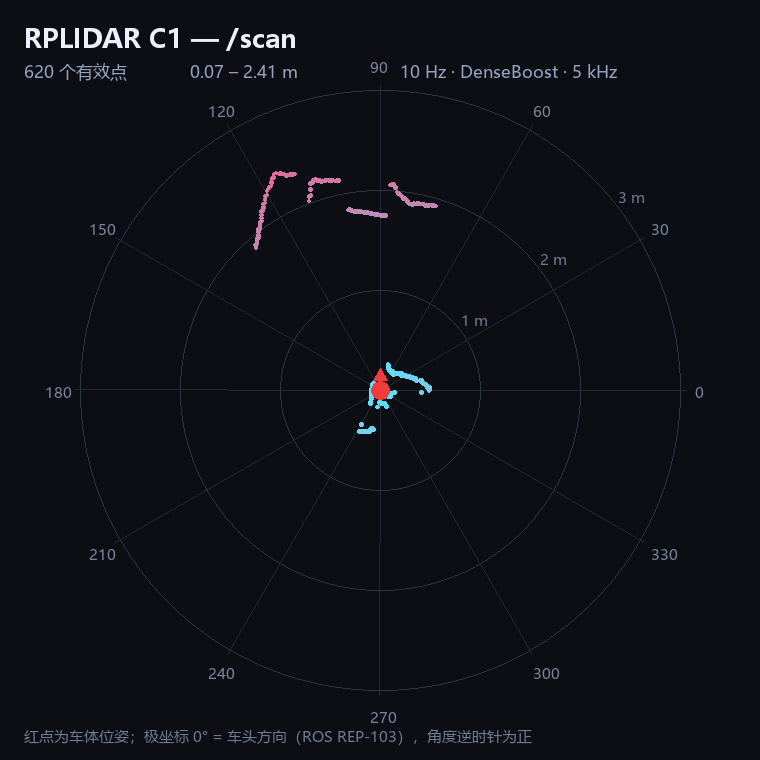
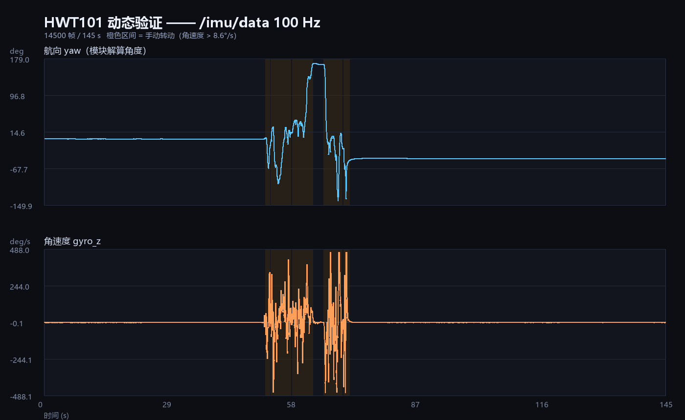

# 思岚 C1 激光雷达 + 维特 HWT101 IMU 功能验证报告

- 日期：2026-11-17
- 平台：Raspberry Pi 5（`pi5`，192.168.50.98），Ubuntu 26.04 arm64，ROS 2 Lyrical
- 结论：**两颗传感器均通过功能验证**，数据质量满足建图/导航的前置要求，可以进入装配与融合联调。

---

## 1. 结论速览

| 设备 | 识别结果 | 关键指标 | 判定 |
|---|---|---|---|
| 思岚 RPLIDAR C1 | `/dev/ttyUSB0` → `/dev/raspbot_lidar`，CP2102N，model `0x41`，460800 8N1 | `/scan` 10.0 Hz、720 线/圈、620 点有效、0.07–2.41 m | **通过** |
| 维特 HWT101 | `/dev/ttyAMA0` → `/dev/raspbot_imu`，115200 8N1 | `/imu/data` 100.0 Hz；静态噪声 0.007°、漂移 0.034°/min；动态角速度与航向积分一致 | **通过** |

两路同时运行时互不干扰：`/scan` 10.07 Hz、`/imu/data` 100.03 Hz。





---

## 2. 设备枚举

```
$ lsusb
Bus 002 Device 002: ID 10c4:ea60 Silicon Labs CP210x UART Bridge   ← C1 载板
Bus 004 Device 002: ID 0c45:64ab Microdia Integrated_Webcam_HD

$ ls -l /dev/raspbot_lidar /dev/raspbot_imu
lrwxrwxrwx  /dev/raspbot_lidar -> ttyUSB0    (crw-rw-rw-, root:dialout)
lrwxrwxrwx  /dev/raspbot_imu   -> ttyAMA0    (crw-rw----, root:dialout)
```

- 系统里**只有一个** USB 串口设备，即 C1 自带 CP2102N；没有 `ttyACM*`。
- HWT101 接 40-pin UART（GPIO14/15 → `ttyAMA0`，PL011 AXI 1f00030000.serial），不是 USB-TTL。
- 两个符号链接由新增的 udev 规则固定，规则文件已入库：`ros2_ws/udev/99-raspbot.rules`。

---

## 3. 思岚 C1 验证

### 3.1 协议层握手（460800）

| 命令 | 响应 |
|---|---|
| `GET_INFO` (0xA5 0x50) | 27 字节：`a5 5a | 14 00 00 00 | 04 | 41 02 01 12 | 52 06 fc …`，即 model=0x41、hw=0x02、fw=0x0112，S/N `5206FC8DC4E09DC4B7949EF9D1A05471` |
| `GET_HEALTH` (0xA5 0x52) | `status=0 (OK)`，errcode 0000 |
| `START_SCAN` (0xA5 0x20) | 描述符 `size=5 type=0x81`，随后进入连续数据流 |

- 注意：`waitResponseHeader` 里的长度字段是 **30 bit size + 2 bit subtype** 的位域（`0x40000005` → size=5/subtype=1），按普通 `uint32` 解析会得到天文数字。
- **扫描数据流里没有 `0xAA 0x55` 包头**。C1 用的是 DenseBoost（capsule）编码，节点是紧凑打包的，按 `sync=0xAA55` 去找包会一无所获——这是自写解析器最容易踩的坑。

### 3.2 ROS 2 层（rplidar_ros，源码编译）

```
[INFO] current scan mode: DenseBoost, sample rate: 5 Khz, max_distance: 15.0 m, scan frequency: 10.0 Hz
$ ros2 topic hz /scan      → average rate: 9.979 / 10.012
```

单帧内容：

```
frame_id=laser  n=720  angle[-3.124, 3.142]  inc=0.00871 rad  (0.5°)
range_min=0.150  range_max=15.0  time_increment=1.414e-04
有效点 620 / 720，距离 0.068–2.407 m，均值 0.522 m
```

图中 120°–160° 方向 2–2.4 m 的三段直边是桌面周围的物体，中心附近的近距离点是小车自身/线束。角度覆盖完整一圈、无空洞、无镜像，说明转速与角度标定正常。

> 实测有效点上限受当前桌面环境影响；C1 标称量程 12 m，这里 `range_max` 用的是驱动默认 15 m，后续按实际场地改。

---

## 4. 维特 HWT101 验证

### 4.1 数据流

```
3 s 内：16522 字节 = 500 帧/s（0x52 角速度 751 帧 + 0x53 角度 750 帧）
```

- 输出速率实测 **250 Hz（每类帧）**，不是出厂 10 Hz —— 模块已被配置过，无需再改。
- **没有 0x51 加速度帧**：`/imu/data` 的 `linear_acceleration` 恒为 0（14500 帧全零）。不影响 `mode=yaw` + `angle_source=device` 的航向输出，但如果要跑 Mahony 或让 EKF 用重力/加速度，需要去维特上位机把加速度输出打开。

### 4.2 静态台架（30 s，`tools/hwt101_static_check.py`）

```
航向均值 : +9.993°
标准差   : 0.0073°  （峰峰值 0.0275°）
线性漂移 : +0.0341 °/min
判定：很好——这颗模块静止状态可以直接用。
```

### 4.3 动态验证（145 s，手动转动）

共识别到 35 段转动（峰值 468 °/s，单段最大 167°、含多圈往返）：

| 检查项 | 结果 |
|---|---|
| 模块角度 Δyaw vs 陀螺积分 ∫ω·dt | 每段偏差 ≤ 0.25°，最大 167.6° vs 167.5° |
| 转向符号 | 角速度与航向同号，右手定则一致 |
| 静止尾段稳定性 | 剧烈转动后 ~30 s 内收敛，之后 40 s 漂移 0.05°/min |
| `/imu/data` 发布率 | 100.03 Hz（目标 100），抖动 σ=0.3 ms |

积分与器件角度逐段吻合，说明 **角速度的符号、量纲和角度通道是自洽的**，EKF 不会因为这两个量打架。

### 4.4 复测（修好统计脚本之后，15 s）

```
总帧数 : 7517（其中角度帧 3758）→ 角度帧率 250.7 Hz   ← 与原始字节统计一致
航向均值 : -45.014°（手动转动后停在这里）
标准差   : 0.0028°   线性漂移 : +0.0329 °/min
```

两条结论：① 4.1 节说的 250 Hz 得到脚本独立确认，原来的 21.5 Hz 确实是把 `read()` 次数当帧数的 bug；② 剧烈转动后重新静态测量，噪声与漂移回到出厂级，说明 §4.3 尾段那 0.3° 是手转之后的机械余振，不是器件漂移。

### 4.5 关于"没固定、不水平"的说明

这次是手持模块随意旋转的（模块没固定在水平面上），需要说清楚这次验证**覆盖了什么、没覆盖什么**：

| 项 | 是否被本次数据证明 |
|---|---|
| 航向跟随转动（方向、幅度、连续到位） | **是**：整段行程 1818°（约 5 圈），解算航向累计 −44.07°，同一段陀螺积分 −45.08°，全程差 **1.01°**（0.055%），多次穿越 ±180° 环绕都没有跳变 |
| 角速度与航向的自洽性（EKF 输入不会打架） | **是**：35 段逐段吻合 ≤0.25° |
| 绝对航向角的准确性（相对真北/墙面） | **否**：手持倾斜 + 无基准，且 HWT101 只有 Z 轴角度，roll/pitch 恒 0（实测 752 帧全零），**倾斜量无法从数据里看出来**，只能靠机械找平 |

所以：这次结果足以判定"模块工作正常、航向可用"，但不能当作"航向绝对精度 1°"的证据。装到车体上找平之后，建议用**对墙基准法**再测一次：车头贴齐一面墙读一次 yaw，原地转 90° 再读一次，差值才是真正的航向精度。


---

## 5. 同时运行

```
/scan      10.07 Hz
/imu/data 100.03 Hz
CPU: imu_node 10.4%（单核）、rplidar_node 1.6%
```

两路都走 `/dev/i2c-1` 之外的总线（USB + UART），互不抢占，也没有出现同一串口被两个进程打开的情况。

---

## 6. 过程中发现并已处理的问题

| # | 问题 | 现象 | 处理 |
|---|---|---|---|
| 1 | `ubuntu` 不在 `dialout` 组 | 打开 `/dev/ttyUSB0` 报 `Permission denied` | `usermod -aG dialout ubuntu`，**需重新登录/重启生效** |
| 2 | `ttyAMA0` 被内核控制台占用 | `/proc/cmdline` 含 `console=ttyAMA0,115200`，且 `serial-getty@ttyAMA0` 处于 active | 已 mask getty；已从 `/boot/firmware/{current,old}/cmdline.txt` 删除 `console=serial0`（备份 `cmdline.txt.bak-20261117-121907`），**重启生效** |
| 3 | 串口权限/设备名不稳定 | `/dev/ttyAMA0` 是 `600 root:tty` | 新增 udev 规则：`raspbot_imu`(dialout 660)、`raspbot_lidar`(666) |
| 4 | `rplidar_ros` 在 Lyrical 上编译失败 | `Unknown CMake command "ament_target_dependencies"`（该宏在新版本已移除）；CMake 4 拒绝 `cmake_minimum_required(VERSION 3.5)` | 把 3 处 `ament_target_dependencies(...)` 换成 `target_link_libraries(... pkg::pkg)`；编译加 `-DCMAKE_POLICY_VERSION_MINIMUM=3.5` |
| 5 | `hwt101_static_check.py` 帧率统计错误 | 按 `read()` 次数算帧率，把 250 Hz 报成 21.5 Hz，并误报「只有 22 Hz，去改 100Hz」 | 已修：`Parser.feed()` 增加 `recent` 列表，一次 read 里的每帧都计入样本；实机复测 250.7 Hz 通过 |
| 6 | 加速度通道缺失 | `linear_acceleration` 恒 0 | **未处理**，见 §7 |

`rplidar_ros` 的改动落在设备上的 `~/ros2_ws/src/rplidar_ros/CMakeLists.txt`（未入本仓库），重新编译需保留同一处替换与 CMake 参数。

---

## 7. 后续建议

1. **重启一次**，让 `cmdline.txt` 与 `dialout` 组生效；重启后复查 `cat /proc/cmdline` 不再有 `console=ttyAMA0`。
2. 用维特上位机打开 **加速度输出**（寄存器 0x02），并把输出速率固定在一个明确值（当前 250 Hz 偏高），否则 `/imu/data` 的加速度恒 0，Mahony 模式不可用。
3. 装车后重新跑一次静态检查，把 §4.2 的数字当基线；加减震柱后再跑一次做对比。
4. 雷达与 IMU 的 **安装外参**（`yaw_offset_deg`、`base_link → laser`）还没标定，当前角度都是“模块自己的 0°”。
5. **HWT101 只输出 Z 轴航向**：实测 roll/pitch 恒为 0（752 帧全零），所以它测不出自己歪没歪——找平只能靠安装面/水平仪，装好后用 §4.5 的对墙基准法复核航向精度。
5. SLAM 前建议给航向加 10–30 Hz 低通（mecanum 振动大），并让 EKF 以 `/scan` 匹配为主、IMU 为辅。

---

## 8. 复现命令

```bash
# 设备
ls -l /dev/raspbot_lidar /dev/raspbot_imu

# IMU 静态检查（30 s，保持静止）
python3 ~/ros2_ws/src/raspbot_imu/tools/hwt101_static_check.py \
        --port /dev/raspbot_imu --baud 115200 --seconds 30

# IMU 节点
ros2 run raspbot_imu imu_node --ros-args --params-file ~/ros2_ws/src/raspbot_imu/config/imu.yaml

# 雷达节点
ros2 run rplidar_ros rplidar_node --ros-args \
  -p serial_port:=/dev/raspbot_lidar -p serial_baudrate:=460800 \
  -p frame_id:=laser -p angle_compensate:=true

# 验收
ros2 topic hz /scan        # ≈10 Hz
ros2 topic hz /imu/data    # ≈100 Hz
ros2 topic echo /scan --once
```

本仓库内的配套文件：

- `ros2_ws/udev/99-raspbot.rules` — 两个设备的固定命名与权限
- `ros2_ws/src/raspbot_imu/tools/hwt101_static_check.py` — 帧率统计已修正
- `tools/plot_lidar_scan.py`、`tools/plot_imu.py` — 生成上面两张图（Pillow，无需 matplotlib）
- `tools/hwt101_level_check.py` — 3 s 读 roll/pitch/yaw，用于确认角度帧正常（并会提示 roll/pitch 恒 0）

> 验证用的原始采集（`data/scan.csv`、`data/imu_motion.csv`）已清理；需要时按 §8 的命令重跑即可复现，`tools/plot_lidar_scan.py` 与 `tools/plot_imu.py` 直接吃这两份 CSV。
