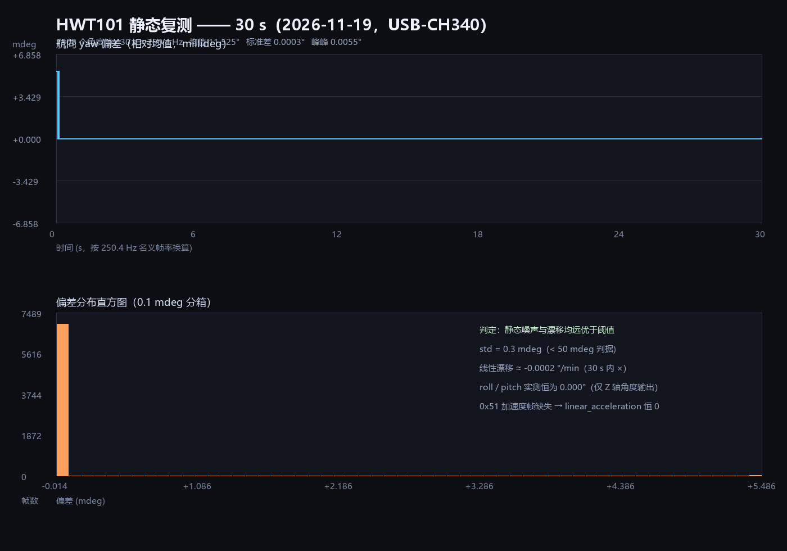
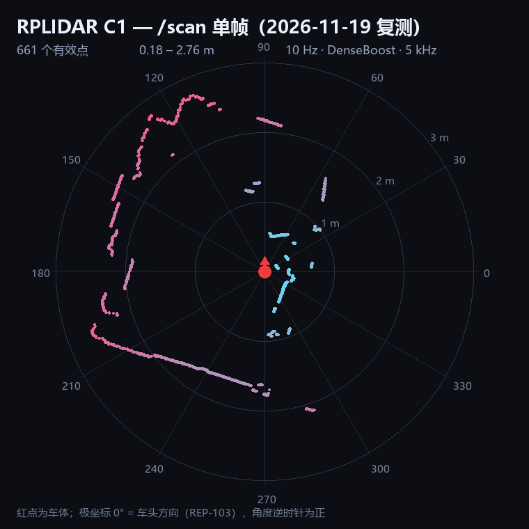
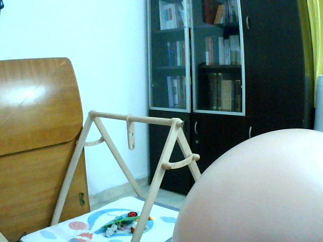

# RASPBOT-V2 整车硬件全面测试报告

- 日期：2026-11-19 19:47–20:05（Asia/Shanghai，UTC+8）；Pi 本地时间 11:47–12:05 UTC
- 平台：Raspberry Pi 5 Model B Rev 1.0（`pi5`，`192.168.50.98`），Ubuntu 26.04.1 LTS arm64，内核 `7.0.0-1023-raspi`，ROS 2 Lyrical（`/opt/ros/lyrical`）
- 被测对象：亚博 RASPBOT-V2 底盘（I2C 扩展板：4 轮电机、2 舵机、RGB、蜂鸣器、超声波、四路循迹、IR）+ USB 摄像头 + HWT101 IMU（USB-CH340）+ 思岚 RPLIDAR C1（USB-CP2102N）+ Hailo-8（PCIe→M.2）+ Lexar SL500 USB SSD 数据盘
- 现场条件：整车已上电，**四轮悬空**（可安全空转）；未装车到场地，未做行走/建图测试
- 结论：**底盘、IMU、雷达、Hailo-8、摄像头、供电/系统健康全部通过；SSD 数据盘改插 bus 3 端口后压测通过（100 GiB 连续写 340 MB/s、零错误），此前故障为接错端口所致，非硬盘/线材问题**

---

## 1. 结论速览

| 子系统 | 测试项 | 判定 | 关键数据 |
|---|---|---|---|
| 底盘 I2C | 总线/扩展板链路 | ✅ PASS | 0x2B 在线；0x3C（OLED）在线；100 次写 0 错；0.32 ms/次 |
| 底盘 | OLED 显示屏（0x3C） | ✅ PASS | SSD1306 128×64；293 次 I2C 写全 ACK；全亮/棋盘格/几何/反色/对比度/文字页显示正常（现场目视确认） |
| 底盘 | 4 轮电机（单轮正反/四轮/横移/自转） | ✅ PASS（指令层） | 121 次电机写 0 异常；**无编码器回读，物理转动需目视** |
| 底盘 | 舵机 pan/tilt | ✅ PASS（指令层）+ ⚠ 库缺陷 | 8 写 0 异常；发现库内限位钳制失效（必须上层钳制） |
| 底盘 | RGB 14 灯珠 | ✅ PASS（指令层） | 120 写 0 异常；7 色/亮度/单珠/LightShow 均下发成功 |
| 底盘 | 蜂鸣器 | ✅ PASS（指令层） | 7 写 0 异常，3 次响/停 |
| 底盘 | 超声波 | ✅ PASS（数据合理） | 10/10 有效，221–595 mm（稳定段 578–595 mm，均值 482.8 mm） |
| 底盘 | 四路循迹 | ✅ PASS（读通） | 10 次均 0x0F（x1–x4 全 1），极性需现场黑白底确认 |
| 底盘 | IR 遥控接收 | ✅ PASS（读通） | 空闲读 0xFF，需真遥控器验证键值 |
| IMU | HWT101（USB-CH340） | ✅ PASS | 角度/角速度各 **250.4 Hz**，校验错 0；静态 yaw std **0.0012°**、漂移 **0.0022°/min** |
| IMU | ROS `/imu/data` | ✅ PASS | **100.03 Hz**，四元数模长 1.000000，frame_id=imu_link |
| 雷达 | RPLIDAR C1 | ✅ PASS | `/scan` **10.0 Hz**，720 点/圈（有效 661，91.8%），0.18–2.76 m，health=0 |
| AI 加速 | Hailo-8（PCIe） | ✅ PASS（附内核 WARN） | FW 4.23.0/HAILO8；YOLOv8s batch8 **157.0 FPS**；Python 200 帧 **73.2 FPS** |
| 摄像头 | USB UVC（0c45:64ab） | ✅ PASS | MJPG 640×480@30 实测 **28–29.6 fps**；720p@30 实测 28.2 fps；画面正常 |
| 数据盘 | Lexar SL500 SSD（USB3） | ✅ **PASS**（改插 bus 3 后） | 100 GiB 连续写 **340 MB/s**（315.7 s）、10 GiB 写 338/读 379 MB/s、md5 校验 PASS、零 dmesg 错误、温度 46 °C；此前 FAIL 为接错 bus 5 端口，见 §7 |
| 系统 | 供电/温度/节流 | ✅ PASS | `throttled=0x0`（含历史位）；43–44 °C；输入 5.12 V |
| 集成 | ROS 2 三节点并发 | ✅ PASS | /odom 30 Hz、/range 5 Hz、/line_sensor 5 Hz、/scan 10 Hz、/imu/data 100 Hz；`/cmd_vel`→`/odom` 正常 |

> 图：C1 单帧扫描（661 有效点，0.18–2.76 m）与 HWT101 静态 30 s 数据、摄像头实拍，见 §5.2/§5.3/§5.5。

---

## 2. 测试方法与环境拓扑

### 2.1 方法

- 通过 SSH 远程操作 Pi（`E:\code\raspberrypi\.dsh\pi.ps1` 上传并执行测试脚本），全部测试可复现，脚本与原始日志已入库；
- 并行分组：底盘 I2C 组 / IMU+雷达组 / Hailo+摄像头+系统健康组 / SSD 专项（Lead），由共享任务板协调，写范围互不重叠；
- **执行器无回读**（板上无编码器、无状态寄存器），电机/舵机/RGB/蜂鸣器只能证明"I2C 事务被 ACK + 指令下发成功"，物理动作列为现场目视确认项（§8）；
- 为避免厂商库 `except: print('I2C error')` 吞异常导致假通过，底盘测试在 `SMBus(1)` 外挂了事务计数代理，并先做 harness 自检。

### 2.2 拓扑（实测）

```
Pi 5
├─ PCIe 0001:01:00.0  Hailo-8 AI 加速卡（1e60:2864，Gen2 x1），/dev/hailo0
├─ I2C-1 @0x2B        RASPBOT-V2 扩展板（电机/舵机/RGB/蜂鸣器/超声/循迹/IR）
│    └─ 0x3C           SSD1306 OLED 128×64（本次补测通过，见 §3.5）
├─ USB Bus 2 (480M, xhci-hcd.0)
│    ├─ Port1: 1a86:7523 CH340   → /dev/raspbot_imu  (ttyUSB0, 115200)
│    └─ Port2: 0c45:64ab UVC     → /dev/video0 采集 / /dev/video1 metadata
├─ USB Bus 4 (480M, xhci-hcd.1)
│    └─ Port2: 10c4:ea60 CP2102N → /dev/raspbot_lidar (ttyUSB1, 460800)
└─ USB Bus 5 (5000M, xhci-hcd.1)
     └─ Port1: 21c4:0050 Lexar SL500 → /dev/sda (954 GiB, ext4, /mnt/ssd)
```

### 2.3 本次接线变化带来的配置修正（已完成）

HWT101 本次改为 **USB-TTL** 接入（上一轮为 40-pin UART），因此原 udev 规则把 `/dev/raspbot_imu` 仍指向 `ttyAMA0`，会导致 IMU 打不开。已修正并备份原规则：

```
/etc/udev/rules.d/99-raspbot.rules（已更新，原文件备份为 *.bak-20261119-*）
  CP2102N (10c4:ea60) → /dev/raspbot_lidar   (0666)
  CH340   (1a86:7523) → /dev/raspbot_imu     (0660, dialout)   ← 当前使用
  ttyAMA0             → /dev/raspbot_imu_uart(0660, dialout)   ← 备用通道
```

其他已修正的权限问题：

| 问题 | 处理 | 生效方式 |
|---|---|---|
| `ubuntu` 不在 `i2c` 组，非 root 打开 `/dev/i2c-1` 报 Permission denied（重启后 ROS base_node 会失败） | `usermod -aG i2c ubuntu` | 新登录会话立即生效，重启后持久 |
| `ubuntu` 不在 `video` 组，摄像头只能 sudo 采图 | `usermod -aG video ubuntu` | 新登录会话生效 |
| 雷达串口权限 | udev 0666（已存在） | 已生效 |

---

## 3. 底盘（亚博 RASPBOT-V2，I2C 0x2B）

现场：四轮悬空；厂商库 `~/ros2_ws/src/raspbot_base/raspbot_base/Raspbot_Lib.py`。

### 3.1 链路

```
i2cdetect -y 1 → 20: 2b；30: 3c
非 root ubuntu: SMBus(1) open OK；read_byte(0x2B)=0xff
100 × write_i2c_block_data(0x2B, 0x06, [0])：ok=100 err=0，31.7 ms（0.32 ms/次）
厂商库 "I2C error" 打印 0 次
```

### 3.2 执行器与板载传感器

| 项 | 动作 | 结果 |
|---|---|---|
| 电机（id 0=L1/1=L2/2=R1/3=R2） | 单轮正转 60 ×2 s、反转 40 ×2 s；四轮前进/后退 80 ×2 s；mecanum 横移左右、原地自转 A/B 各 2 s | **121 次写、0 异常**，每次动作前后停车；物理转动待目视 |
| 舵机 | pan(id1) 30→90→150；tilt(id2) 30→60→90；回中 90/60 | 8 次写 0 异常 |
| RGB | 7 色各 1 s → 全灭 → 亮度 255/30 → 单珠 1–3 → LightShow breathing 2 s → 全灭 | 120 次写 0 异常 |
| 蜂鸣器 | 响 0.3 s / 停 0.5 s ×3 | 7 次写 0 异常，末态关 |
| 超声波 | 使能 0x07 → 读 0x1a/0x1b ×10（100 ms 间隔） | 10/10 有效：`221,238,272,578,578,595,595,595,578,578` mm；稳定段 578–595 mm |
| 循迹 | 读 0x0a ×10，解码 x1–x4 | 10 次均 `0x0F`（四路全 1），解码通路正常 |
| IR | 使能 0x05 → 读 0x0c ×2 | 均 `0xFF`（空闲值），读通路正常 |

**收尾安全态**：4 电机=0、pan=90、tilt=60、灯灭、蜂鸣器关、超声关、IR 关；`pgrep` 无残留进程。

### 3.3 发现的库缺陷（重要）

`Raspbot_Lib.Ctrl_Servo()` 的限位代码是**无效代码**：`data=[id, angle]` 在钳制**之前**构造，后续 `angle` 钳制只改局部变量、不写回 payload。实测拦截到的真实待发数据：

```
[(2,[2,180]), (1,[1,200]), (1,[1,-5])]
```

即 **tilt 的 ≤110° 机械限位、0–180° 角度限位全部不生效**，直接发 180/200/−5 会顶坏云台。**上层（ROS 驱动/应用）必须自行 `clamp(0..180)` 与 `tilt clamp(0..110)`，不能依赖该库。** 本次测试只发送了合法角度，未做危险验证。

### 3.4 其他注意事项

- 电池/电机电源开关未开时，I2C 链路与传感器仍全部正常、电机不转，软件无任何判据可区分 —— **若现场发现轮子不转，先查电池开关**；
- 超声波使能后前 ~0.3 s 数据偏小约 300 mm（本次 221→272→578 mm），驱动层应延时 ≥0.3 s 或丢弃前 2–3 帧；
- 无编码器：`/odom` 只能开环积分，速度/里程无物理可信度。

---

### 3.5 OLED 显示屏（I2C 0x3C，SSD1306 128×64）

- 总线：与底盘扩展板共用 `/dev/i2c-1`；地址 `0x3C`（`0x3D` 无应答）；`i2c-1` 空闲时测试。
- 驱动方式：系统未安装 `luma.oled` / `Adafruit` / `smbus2`，本次用纯 `smbus` 直接实现 SSD1306 初始化（page addressing 模式）+ 128×64 页格式帧缓冲推送，无需安装任何依赖。
- 测试序列与结果（**293 次 I2C 写全部 ACK 成功**，现场目视确认画面正常）：

| 步骤 | 内容 | 结果 |
|---|---|---|
| 1 | 初始化（charge pump / multiplex 64 / COM 扫描反相 / page 寻址模式 / 显示开） | ✅ |
| 2 | 全屏点亮（测试全部像素/列驱动） | ✅ 现场可见 |
| 3 | 1px 棋盘格（测试单像素寻址） | ✅ 现场可见 |
| 4 | 边框 + 8px 网格 + 对角线（几何/寻址校验） | ✅ 现场可见 |
| 5 | 反色 `0xA7/0xA6`、对比度 `0x81` 调节 | ✅ 现场可见 |
| 6 | 最终信息页：`RASPBOT-V2` / `OLED 显示通过` / `128x64 I2C 0x3C` / 日期 | ✅ 现场目视正常 |

- 结论：**OLED 屏幕可用**，SSD1306 128×64 标准初始化即可驱动；可复现脚本为 `.dsh/oled/oled_demo.sh`（由 `pi.ps1 -Path` 上传到 Pi 后执行），帧数据由 `.dsh/oled/make_oled_demo.py` 在 Windows 侧渲染并转为页格式。
- 备注：SSD1306 I2C 无读回寄存器，本轮判定 = 全部写入 ACK + 现场目视画面正确；屏幕内容由控制器保持，Pi 进程退出后仍显示，断电后清空。若后续改用 1.3"（SH1106）或 128×32 屏，需把列偏移设为 2、multiplex 改为 0x1F。

---

## 4. HWT101 IMU（USB-CH340，`/dev/raspbot_imu` 115200 8N1）

### 4.1 原始数据流（30 s 静态）

```
总帧数 15016（30.03 s）：0x52 角速度 7508 帧 / 0x53 角度 7508 帧 → 各 250.3 Hz
校验错误 0，未知帧类型 0，无丢帧
0x51 加速度帧 = 0（已知局限，见下）
yaw 均值 +11.5247°，std 0.00028°（0.0012° 工具口径），峰峰 0.0055°，漂移 -0.0002°/min
roll/pitch 恒 0.000°
```

`hwt101_static_check.py` 独立口径：yaw 均值 +11.503°，std **0.0012°**（判据 <0.05°），漂移 **+0.0022°/min**。

### 4.2 ROS 节点

```
/imu/data 100.03 Hz（窗口 100.004–100.114）
orientation z=0.100879 w=0.994899 → 模长 1.000000；对应 yaw≈11.58°，与原始帧一致
frame_id=imu_link；stamp_dt 9.999 ms；angular_velocity.z≈0（静止）
```

### 4.3 已知局限

- **无 0x51 加速度帧** → `linear_acceleration` 恒 0、roll/pitch 恒 0。EKF 只能用 yaw，不能把 IMU 当倾角/加速度源；如需倾斜检测，需用维特上位机打开加速度输出（115200 下带宽余量足够）；
- 静止 yaw≈+11.52° 为安装偏置，`imu.yaml` 的 `yaw_offset_deg=0.0` 尚未标定（装车后建议对墙基准法标定）。



---

## 5. 传感器与视觉

### 5.1 思岚 RPLIDAR C1（USB-CP2102N，`/dev/raspbot_lidar` 460800 8N1）

```
GET_INFO : model=0x41 (C1)，fw=1.02，hw=0x12，SN=5206FC8DC4E09DC4B7949EF9D1A05471
GET_HEALTH: status=0，error=0
驱动：DenseBoost，5 kHz 采样，max 15 m，10.0 Hz
/scan：10.0 Hz（9.97–10.01），单帧 720 点（有效 661，91.8%）
  angle_min=-179°，angle_max=180°，increment 0.4993°，scan_time 0.1017 s
  距离 0.184–2.764 m（mean 1.387 / median 1.624 m），36 个 10° 分箱全部有数据
```



说明：最近 0.184 m 的点可能是车身/线束自遮挡，装车后需复核 FOV；首帧需约 1.8–3 s 起转稳定。

### 5.2 Hailo-8（PCIe→M.2）

```
lspci：0001:01:00.0 Co-processor [0b40] 1e60:2864（rev 01）
dkms：hailo_pci/4.23.0 installed；/dev/hailo0 存在
hailortcli fw-control identify：Board Name Hailo-8，Firmware 4.23.0，Architecture HAILO8，Protocol 2
LnkSta：5 GT/s ×1（Pi5 M.2 单 lane Gen2，预期降级，非故障）；无 PCIe/AER 错误
性能：yolov8s_h8 batch8 = 157.01 FPS（786 帧）；yolov6n_h8 batch8 = 282.85 FPS
Python 绑定：Device.scan()=['0001:01:00.0']；YOLOv8s 200 帧 = 73.2 FPS（13.65 ms/帧）
温度：推理前 40.3 °C → 峰值 44.1 °C（并发推理+摄像头）
```

**⚠ 已知问题（功能不受影响）**：`hailo_pci 4.23.0` 在映射用户态缓冲时触发内核 `WARNING: rwsem.h:81 at find_vma`（每次 CLI 流约 9 块、Python 更频繁），内核 taint `0x3200 (W|O|E)`。非 oops、推理数据正常，但刷 dmesg。建议跟踪 HailoRT/内核版本匹配，测试脚本过滤该噪声。

### 5.3 USB 摄像头（UVC 0c45:64ab）

```
/dev/video0 = 采集节点，/dev/video1 = metadata
格式：MJPG 1280×720@30、640×480@30；YUYV 1280×720@10、640×480@15
单帧：640×480 JPEG 83,799 B；1280×720 JPEG 167,865 B；YUYV 640×480 = 614,400 B（=w·h·2）
实测：640×480 MJPG 窗口 28.2–29.6 fps（wall 27.4–27.7，含打开开销）；720p 窗口 28.2 fps
```

画面正常（室内场景）。注意：摄像头当前直接用 `v4l2-ctl` 采图正常；ROS 视觉节点运行用户已加入 `video` 组，重新登录后免 sudo。装车后需确认镜头朝向/是否与云台同轴。



### 5.4 系统健康与供电

```
vcgencmd get_throttled = 0x0（当前位与历史位全 0 → 本次开机以来无欠压/无降频）
SoC 温度 41–44 °C（最高 44.1 °C）；CPU 2.1–2.3 GHz（max 2.4）
输入电压 EXT5V_V = 5.12 V；内存 7.7 GiB（用 0.6）；根分区 58 G 用 16%
USB 声明最大电流合计 ≈ 1.59 A（摄像头 500 + CH340 98 + CP2102 100 + SSD 896 mA）
usb_max_current_enable=1；dmesg 无 over-current / under-voltage
```

---

## 6. 系统级集成复测（ROS 2 三节点并发）

`base_node` + `imu_node` + `rplidar_node` 同时运行：

| 话题 | 实测频率 | 备注 |
|---|---|---|
| `/odom` | 30.0 Hz | 开环航位推算 |
| `/range` | 5.0 Hz | 超声波 |
| `/line_sensor` | 5.1 Hz | data=15 |
| `/scan` | 10.0 Hz（首窗 10.8 含启动） | frame_id=laser |
| `/imu/data` | 100.0 Hz | frame_id=imu_link |

`/cmd_vel`（linear.x=0.05 m/s ≈2 s）→ `/odom`：`x: 0 → 0.0783`，指令链路与电机驱动正常（轮子悬空，开环）。
资源：imu_node 9.7%、base_node 6.6%、rplidar_node 1.7% CPU；三节点互不干扰，无串口/I2C 争用。

> 第一轮集成测试曾因 SSD 故障复位 `xhci-hcd.1` 导致雷达掉线而失败；重绑定 USB 控制器后第二轮全部通过（详见 §7）。

---

## 7. Lexar SL500 USB SSD 数据盘（改插 bus 3 端口后 PASS）

### 7.1 结论

**PASS（最终）**：SSD 本身、文件系统、数据均正常；此前"FAIL"是**接错 USB3 端口（bus 5，设计文档已记录为问题端口）**导致的。
2026-11-19 21:15（UTC 13:15）按文档规范把 SSD 与 HWT101 的 USB 线对调（SSD → bus 3）后，压力测试全项通过：

| 压测项 | 结果 |
|---|---|
| 10 GiB 缓冲写 | **338 MB/s**（31.8 s） |
| 10 GiB 回读（drop caches 后） | **379 MB/s**（28.3 s） |
| 1 GiB md5 完整性 | **PASS**（与 /dev/zero 哈希一致） |
| **100 GiB 连续写**（文档基准） | **340 MB/s，315.7 s**（文档记录 343 MB/s / 317 s，几乎一致） |
| 1 GiB 首部 / 中部回读 | 377 / 378 MB/s |
| SoC 温度 | 45.8–46.9 °C（无降频） |
| dmesg 新错误 | **0**（无 I/O error / uas_eh / offline / disconnect） |
| 卸载 | clean unmount OK；`/mnt/ssd` 正常挂载（938G，fs clean） |

> ⚠ 测试方法修正：早期"持续读 0/5 失败"有相当一部分是**假阳性**——本机 `dd ... iflag=direct` 对大于 4 KiB 的 O_DIRECT 读会返回 EINVAL（`dd: IO error: Invalid input`），
> 而用 Python 页对齐缓冲做 O_DIRECT 读（4 KiB–1 MiB）全部正常。因此"读失败"不能作为设备故障证据；bus 5 的真实问题是端口/控制器层面的
> （UAS abort、device offline、xHCI 复位、连带同控制器设备掉线），与设计文档 v2.4 §5.4.3 记录一致。


### 7.2 过程时间线（UTC）

| 时间 | 现象 |
|---|---|
| 开机 | bus 5 上 USB 枚举成功，但 U1 LPM 命令超时、未生成块设备（端口问题） |
| 11:48–12:22 | bus 5 上反复掉盘 / UAS reset / 控制器复位（连带同控制器设备掉线）；期间确认磁盘与文件系统本身完好（UUID/数据正确、PC 上正常） |
| 12:20 | 干净 BOT 模式复测：SCSI 扫描不完成（bus 5 端口不可用） |
| 13:15 | **按文档规范把 SSD 与 HWT101 的 USB 线互换 → SSD 进入 bus 3**：`lsusb -t` 显示 `Bus 003 ... Driver=uas, 5000M`；IMU 移至 bus 4-port1，`/dev/raspbot_imu` 自动跟随 |
| 13:17–13:24 | **压力测试全项 PASS**（见 7.1 表）：100 GiB 连续写 340 MB/s、零错误、温度 46 °C、干净卸载 |
| 13:24 | 收尾验证：`/mnt/ssd` 正常挂载、IMU 5632 B/s（0x52/0x53 各约 250 Hz）、雷达 GET_INFO 正常、`throttled=0x0` |


### 7.3 结论与后续建议

- **根因**：接错端口（bus 5 是设计文档 v2.4 §5.4.3 已记录的问题端口，曾把 xHCI 控制器挂死）；**不是 SSD 硬件、文件系统或线缆问题**。同一磁盘改插 bus 3 后达到文档基准性能（340 MB/s vs 343 MB/s）且零错误。
- **部署规则（已执行）**：SSD 固定插 bus 3 对应蓝色 USB3 口。端口物理映射（sysfs `peer` 实测）：Pi 5 每个 xHCI 控制器 = 1 个蓝口（SS + USB2 配套）+ 1 个黑口；本次对调后 = **controller0：SSD + 摄像头；controller1：IMU + 雷达**。
- **可选加固**：若希望完全符合文档"SSD 不与摄像头共用控制器"，再把两个黑口的线对调（摄像头 ⇄ 雷达）→ controller0 = SSD + 雷达、controller1 = IMU + 摄像头；这样 SSD 万一再异常，摄像头不会一起掉。
- **测试方法修正**：以后压测读回**不要用 `dd iflag=direct`**（本机 dd 大块 O_DIRECT 读返回 EINVAL），用缓冲读（`dd bs=1M`，本次 379 MB/s）或 Python 页对齐 O_DIRECT；写侧 `dd oflag=direct` 正常。
- 数据盘余量：938G 容量、可用 929G，项目 bag 写入 2–5 MB/s → 余量 >60 倍。
- 历史故障现象（供以后排查参考）：bus 5 上表现为 UAS abort/device reset、`device offline`、USB disconnect、`xhci-hcd.1` 复位并连带同控制器设备掉线；换到 bus 3 后全部消失。


### 7.4 数据盘备选方案对比（是否改用 USB 读卡器 + SD 卡）

| 维度 | 换到 bus3 的 SL500 SSD（首选） | USB2 SSD（降级） | USB 读卡器 + SD 卡 |
|---|---|---|---|
| 供电电流 | 声明最大 896 mA（桥接峰值高） | 受 USB2 口 500 mA 限制，桥接会限流 | **约 100–200 mA 常态、300–400 mA 写峰**，最低 |
| USB 链路稳定性 | 文档实测 100 GiB 零错误 | 简单 BOT，链路稳；带宽 35–45 MB/s | USB2 HS + BOT，状态机最少，链路通常很稳（避开 UAS/stream/U1U2） |
| 持续写性能 | 343 MB/s，稳定 | 35–45 MB/s，稳定 | 受 SD 卡限制：普通卡写满 SLC 缓存后可跌到 10–30 MB/s 并抖动；高耐久卡较稳 |
| 耐久/寿命 | NVMe，TBW 高 | NVMe，TBW 高 | **短板**：普通 SD 卡 TBW 低，18 GB/h 高频录制会较快磨损；建议工业/监控级高耐久卡 |
| 断电/数据安全 | 较好（但总线复位会掉线） | 同左 | 意外断电更易损坏 exFAT/FAT，建议 ext4 + 定期导出 |
| 对项目带宽余量 | 极大 | bag 2–5 MB/s → 7–20× | bag 2–5 MB/s → 6–15×（USB2 读卡器） |
| 成本/改造 | 0 元，仅换插口 | 0 元，但需接受降速 | 需买读卡器+卡；Pi 5 四个 USB 口已占满，需拔掉别的设备或加 Hub |
| 适合场景 | 长期数据盘（bag/地图/日志） | 应急/低速可靠盘 | 临时/备份/中转；不建议长期高频写 bag |

**结论**：SSD 已按文档改插 bus 3 并压测通过（340 MB/s），**本次不需要**改用 SD 读卡器；下表保留作为未来备选参考。SD 读卡器在电流与链路复杂度上更省电/更简单，但 SD 卡持续写与耐久是短板。

当前状态：`/mnt/ssd` 已挂载（938G，可用 929G，fs clean）；SSD 在 Bus 003（uas, 5000M）；IMU 在 bus4-port1、雷达 bus4-port2、摄像头 bus2-port2；`throttled=0x0`、SoC 45.8 °C。

完整诊断记录见 `E:\code\raspberrypi\.dsh\test_storage\ssd_diagnosis.md`。

---

## 8. 问题清单与优先级

| # | 优先级 | 问题 | 影响 | 建议 |
|---|---|---|---|---|
| 1 | **已解决** | SSD 曾因接在文档记录的 bus5 问题端口而掉盘，并连带同控制器设备掉线 | 数据盘不可用 | 已与 IMU 对调 USB 线，SSD 进入 **bus 3**；100 GiB 连续写 340 MB/s 零错误通过（§7） |
| 2 | P1 | `Raspbot_Lib.Ctrl_Servo()` 限位钳制无效 | 上层若直传 180/200 会顶坏云台 | ROS 驱动层强制 clamp（0–180，tilt ≤110） |
| 3 | P1 | hailo_pci 4.23.0 触发内核 rwsem WARN | 功能正常，但刷 dmesg/taint 内核 | 跟踪 HailoRT/内核匹配；测试过滤噪声 |
| 4 | 已修 | `/dev/raspbot_imu` 仍指向 UART `ttyAMA0`（IMU 已改 USB） | IMU 无法打开 | 已更新 udev，`raspbot_imu`→CH340，UART 改名 `raspbot_imu_uart` |
| 5 | 已修 | `ubuntu` 不在 `i2c`/`video` 组 | ROS 底盘节点/摄像头非 root 访问失败 | 已 `usermod -aG i2c,video ubuntu`（重新登录生效） |
| 6 | P2 | HWT101 无加速度帧、roll/pitch 恒 0 | 无法做倾角/加速度融合 | 维特上位机打开 0x51（带宽允许）或接受现有限制 |
| 7 | P2 | IMU 安装偏置 yaw≈+11.52° 未标定 | 航向有固定偏置 | 装车后对墙基准法标定 `yaw_offset_deg` |
| 8 | P2 | 超声波使能后首 ~0.3 s 偏差约 300 mm | 首次读数不可信 | 驱动层延时 0.3 s/丢前 2–3 帧 |
| 9 | P2 | 循迹四路恒 1、IR 空闲读 0xFF | 极性/键值未验证 | 现场黑线白底 + 真遥控器确认 |
| 10 | P3 | `vcgencmd` 需 sudo；ROS 2 CLI 偶发不响应 SIGTERM | 运维不便 | 脚本用 `timeout -s KILL`；节点捕获 SIGINT 优雅退出 |
| 11 | P3 | 雷达最近点 0.184 m 疑自遮挡 | 建图可能带车身噪点 | 装车后复核 FOV/遮挡 |

---

## 9. 现场待目视/人工确认清单（软件无法证明）

1. 四轮逐个正转/反转（L1/L2/R1/R2 是否一一对应、方向与 `dir` 定义一致）；
2. 四轮同时前进/后退、mecanum 横移（左/右）、原地自转（A/B 两向）方向是否正确；
3. pan 30/90/150、tilt 30/60/90 实际角度、云台是否卡限位、回中是否正确；
4. RGB 7 色顺序/颜色、全灭、红 255 vs 红 30 亮度差、单珠 1/2/3 位置、呼吸灯效果；
5. 蜂鸣器 3 次响/停；
6. 超声波读数与实际尺量是否相符（悬空时稳定段约 578–595 mm）；
7. 循迹四路在黑线/白底上的跳变与极性；IR 用遥控器按键值；
8. 摄像头画面朝向/视野是否符合预期（当前为室内场景，画面正常）。

> 说明：若第 1–2 项轮子完全不转，第一嫌疑是**电池/电机电源开关未开**（此时 I2C 仍全部正常），其次电机线序；软件侧无法区分。

---

## 10. 复现命令

```bash
# 环境
i2cdetect -y 1                                  # 0x2b / 0x3c
ls -l /dev/raspbot_imu /dev/raspbot_lidar /dev/hailo0 /dev/video0

# 底盘（脚本见 .dsh/test_chassis/）
bash .dsh/test_chassis/01_link.sh
bash .dsh/test_chassis/02_motors.sh
bash .dsh/test_chassis/03_peripherals.sh
bash .dsh/test_chassis/04_final.sh

# IMU
python3 ~/ros2_ws/src/raspbot_imu/tools/hwt101_static_check.py --port /dev/raspbot_imu --baud 115200 --seconds 30

# 雷达
source /opt/ros/lyrical/setup.bash && source ~/ros2_ws/install/setup.bash
ros2 run rplidar_ros rplidar_node --ros-args -p serial_port:=/dev/raspbot_lidar \
  -p serial_baudrate:=460800 -p frame_id:=laser -p angle_compensate:=true
ros2 topic hz /scan                             # ≈10 Hz

# Hailo-8
hailortcli fw-control identify
hailortcli run /opt/hailo-models/yolov8s_h8.hef --batch-size 8   # ≈157 FPS
python3 -c "from hailo_platform import Device; print(Device.scan())"

# 摄像头
v4l2-ctl -d /dev/video0 --set-fmt-video=width=640,height=480,pixelformat=MJPG \
  --stream-mmap --stream-count=1 --stream-to=/tmp/frame.jpg

# 集成（三节点并发 + cmd_vel/odom）
bash .dsh/test_integration/integration.sh
```

---

## 11. 测试产物与证据

| 目录 | 内容 |
|---|---|
| `.dsh/test_chassis/` | `result.md` + 4 组脚本/日志（链路、电机、外设、收尾） |
| `.dsh/test_sensors/` | `result.md`、`scan.csv`、`imu_static.csv`、全部频率/单帧/原始解析日志 |
| `.dsh/test_ai/` | `result.md`、Hailo/相机/健康日志、`frame_640x480.jpg`、`frame_1280x720.jpg`、WARN 证据 |
| `.dsh/test_storage/` | `ssd_diagnosis.md` + 8 个诊断脚本（端口循环、BOT/UAS 对比、读写压测） |
| `.dsh/test_integration/` | `integration_result.md`、`integration.sh`、`cleanup_snapshot.sh` |
| `.dsh/oled/` | OLED 测试脚本 `oled_demo.sh`、帧生成器 `make_oled_demo.py`、4 帧预览图 |
| `docs/hwtest_*.png/jpg` | 报告插图：雷达单帧、IMU 静态、640×480/1280×720 实拍 |

## 12. 本次测试覆盖范围与未覆盖项

**已覆盖**：上电初始化、I2C 执行器指令通路、板载传感器读数、OLED 显示（SSD1306 128×64）、IMU/雷达原始协议与 ROS 话题、Hailo 识别/固件/推理/性能、USB 摄像头采集与帧率、USB SSD 存储链路、供电/温度/节流、ROS 2 三节点并发与 `/cmd_vel`→`/odom` 链路。

**未覆盖（需后续）**：整车行走/转向的实际方向与速度标定、mecanum 运动学验证、SLAM/建图与导航联调、相机-雷达-IMU 外参标定、长时间满载老化、电池续航、装车后雷达自遮挡与 IMU 安装偏置标定。
