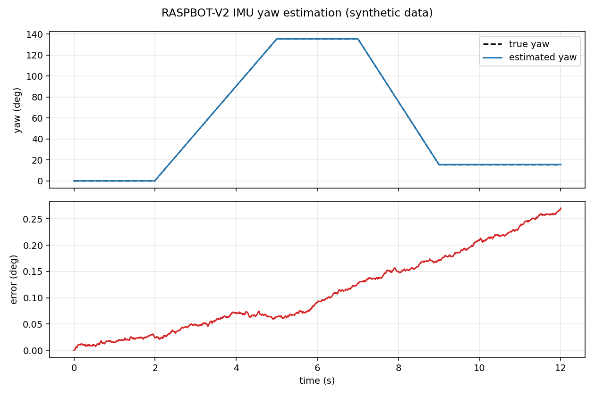

# raspbot_imu — IMU 驱动与姿态解算

给 RASPBOT-V2（树莓派 5 / Ubuntu 26.04 / ROS 2）用的 IMU 包：支持 **ICM-42688-P（SPI 裸芯片，无人机 IMU 下放）** 与 **维特智能 HWT101（串口）**，统一发布 `sensor_msgs/Imu` 到 `/imu/data`。

设计要点：

- **姿态自己算**。ICM-42688 只给原始角速度/加速度，本包用 Mahony 互补滤波或纯 Z 轴积分得到姿态；HWT101 走同一套接口。
- **地面车默认 `yaw` 模式**：只积分 Z 轴角速度，不做重力修正，加减速不会把航向带偏；航向漂移靠启动零偏标定 + 雷达/地图匹配兜底。
- **可复用到无人机**：`mode=mahony` 输出完整 6 轴姿态；换平台只需改参数。
- **无硬件也能验证**：`mock` 数据源 + 单元测试 + 离线 demo。
- **消息组装与参数校验是纯函数**：`msgs.py` / `config.py` 不 import ROS 包，在开发机（无 ROS）上也能直接跑 pytest。
- **断线不崩溃、不发假值**：数据源读/处理异常时节点计数、限频告警（≤1 次/5 s）并停止发布，源恢复后自动继续发布（FR-B-04）。

## 目录结构

```
raspbot_imu/
├── config/imu.yaml          # 参数模板（当前硬件：HWT101 串口）
├── launch/imu.launch.py
├── raspbot_imu/
│   ├── attitude.py          # 四元数、Mahony、YawEstimator、零偏估计
│   ├── config.py            # validate_config 参数校验（纯函数）
│   ├── icm42688.py          # SPI 驱动（寄存器地址已与数据手册/内核驱动核对）
│   ├── msgs.py              # build_imu_dict 消息组装（纯函数，不 import sensor_msgs）
│   ├── sources.py           # ImuSource 抽象 + Mock + WitMotion 串口
│   ├── node.py              # ROS 2 节点
│   └── demo.py              # 离线演示（合成数据 + 曲线图）
└── test/                    # 43 个单元测试，无需硬件
```

## 先在电脑上验证（不需要树莓派）

```bash
cd ros2_ws/src/raspbot_imu
python3 -m pytest test -q          # 43 passed
python3 -m raspbot_imu.demo --mode yaw --duration 12
```

demo 会打印航向 RMSE 并生成 `imu_attitude_demo.png`。参考结果（合成数据，含 0.02 rad/s 的 Z 轴零偏）：

```
航向 RMSE : 0.136 °
最大误差  : 0.270 °   （12 s）
```



## 树莓派 5 部署

```bash
sudo apt install python3-spidev          # 或 pip install spidev
sudo usermod -aG spi,dialout $USER       # 重新登录生效
# /boot/firmware/config.txt 增加：dtparam=spi=on
# 串口方案再加：dtparam=uart0=on（并去掉 cmdline 里的 console=serial0）
cd ~/ros2_ws && colcon build --packages-select raspbot_imu
source install/setup.bash
ros2 launch raspbot_imu imu.launch.py
```

验证：

```bash
ls -l /dev/spidev0.0
ros2 topic hz /imu/data
ros2 topic echo /imu/data --once
```

## 接线

### ICM-42688-P（SPI，推荐）

| 模块引脚 | 树莓派 5 40-pin | 说明 |
|---|---|---|
| VCC | pin 1 / 17（3.3V） | **必须 3.3V**，不要 5V |
| GND | pin 6 | 共地 |
| SCLK / SCL | pin 23（GPIO11） | SPI0 SCLK |
| SDA / MOSI | pin 19（GPIO10） | SPI0 MOSI |
| SDO / MISO | pin 21（GPIO9） | SPI0 MISO |
| CS | pin 24（GPIO8） | SPI0 CE0 |
| INT1（可选） | pin 11（GPIO17） | 当前驱动用轮询，可不接 |

- 模块刚性固定在车体几何中心附近，X 轴朝车头、Z 轴朝上；加减震柱，远离电机与电源线。
- 驱动默认 SPI 模式 3、2 MHz；WHO_AM_I 读不到会直接报错，不会“静默成功”。

### HWT101（串口 / USB-TTL）

```text
HWT101 VCC → 3.3V（pin 1 或 17）   ← 模块 3.3–5.5V，用 3.3V 电平最干净
HWT101 GND → GND（pin 6）
HWT101 TX  → pin 10（GPIO15 / RXD） ← TX/RX 必须交叉
HWT101 RX  → pin 8 （GPIO14 / TXD）
```

- 默认 **115200 8N1**，和驱动默认值一致，不用改；**出厂输出速率是 10Hz，要用维特上位机改到 100Hz**
  （不改的话 `/imu/data` 只能到 10Hz，EKF 会抖）。
- 供电 3.3–5.5V（9.5mA）。若买的是 **HWT101CT**（IP67 工业版），供电是 5–36V，接 5V。
- 用 5V 供电时要先量 TX 空闲电平；3.3V 供电则逻辑电平就是 3.3V，直接接。
- 串口要先启用：`config.txt` 加 `enable_uart=1`，`cmdline.txt` 去掉 `console=serial0,115200`；
  用 `/dev/ttyAMA0`（不是 `ttyS0`）。用 USB-TTL 时设备名会变成 `/dev/ttyUSB0`，建议加 udev 固定：

```udev
SUBSYSTEM=="tty", KERNEL=="ttyAMA0", SYMLINK+="raspbot_imu"
# USB-TTL（CH340）时改用：
# SUBSYSTEM=="tty", ATTRS{idVendor}=="1a86", ATTRS{idProduct}=="7523", SYMLINK+="raspbot_imu"
```

- **航向直接用模块的解算结果**：`angle_source: device`（默认已是）。HWT101 内部做了卡尔曼融合，
  输出 Z 轴角度（0.1°、几乎不漂），比我们自己积分陀螺好一个量级，所以 `mode: yaw` 下不再积分。
  想退回原来的积分逻辑就设 `angle_source: gyro`（换 ICM-42688 时用）。
- 模块必须**水平**安装：歪 1° → 航向系统性偏 1°，`yaw_offset_deg` 只能补绕 Z 的偏角，补不了倾斜。
- 焊针脚：正式装车用**弯针（90°）或直接焊线**，竖起来的直针会让线束的力臂把模块拽弯、航向慢漂。
  详见 `mech/README.md` §6.1。**台架测试阶段用直针没问题**——线不通电、也不装车。

### 第一次上电：台架验证（10 分钟）

```bash
# 只接 VCC/GND/TX 就能读到数据（模块默认单向输出，RX 可以先不接）
python3 tools/hwt101_static_check.py --seconds 60
# 默认端口 /dev/raspbot_imu（udev 固定名）；直连时用 --port /dev/ttyUSB0 覆盖
```

脚本会打印：帧率、航向均值、标准差（噪声）、线性漂移（°/min），并给一句判定。

| 结果 | 含义 | 下一步 |
|---|---|---|
| 帧率 ≈10 Hz | 还是出厂速率 | 用维特上位机改到 100 Hz |
| 标准差 < 0.05°、漂移 < 0.1°/min | 模块状态很好 | 直接进装配 |
| 标准差 0.05–0.2° | 桌面上的正常水平（含量化噪声） | 可用，SLAM 前加 10–30Hz 低通 |
| 噪声大 / 漂移大 | 别急着怪模块 | 依次查：是否水平、线束是否在拽、附近有没有电机线/电源、模块有没有被胶带勒住 |

把这次的数字记下来——以后装上车、加减震柱之后再跑一次，就知道**结构改动的效果**（这也是判断“直针改弯针值不值得”的唯一客观依据）。

> 测试时一个典型假故障：手一碰线束，航向就跳 0.5°。那不是电气噪声，是线束的力矩让板子形变——
> 松手后角度会慢慢回弹。看到这个现象，就说明正式装配必须做应力释放。

## 参数（`config/imu.yaml`）

| 参数 | 默认 | 说明 |
|---|---|---|
| `source` | `witmotion` | `witmotion`（HWT101）/ `icm42688` / `mock` |
| `mode` | `yaw` | `yaw` 只算航向；`mahony` 全姿态（会忽略器件角度） |
| `angle_source` | `device` | `device` 用模块自带角度；`gyro` 自己积分 |
| `rate_hz` | 100 | 发布频率，与契约一致 |
| `calibrate_seconds` | 5.0 | 上电静止标定；0 表示跳过 |
| `yaw_offset_deg` | 0 | IMU 安装方向相对车头的偏角 |
| `serial_port` / `baud` | `/dev/raspbot_imu` / 115200 | HWT101 用 |
| `gyro_fs_dps` | 500 | ICM-42688 用；地面车够用 |
| `accel_fs_g` | 4 | 无人机改 8/16 |
| `odr_hz` | 1000 | 芯片输出速率 |
| `orientation_yaw_variance` | 0.0003 | 填给 EKF 的航向方差，按实际漂移调 |

## 算法与标定

- **angle_source=device**：`orientation` 直接用 HWT101 的 Z 角度，`angular_velocity` 仍是模块原始角速度；
  `YawEstimator` / 零偏标定都不参与（0.1° 的模块角度不需要我们再积分）。
- **YawEstimator**（`angle_source=gyro`）：`yaw += (gyro_z - bias_z) * dt`；检测到静止（角速度小、加速度模长≈g）时用 EMA 慢速跟踪 `bias_z`。
- **MahonyAHRS**：加速度计只在模长接近 g 时参与修正（默认 ±25% 门限），线性加速度/冲击被门限挡掉；**yaw 零偏必须靠启动标定**（重力无法观测航向）。
- **零偏标定**：静止采集，计算三轴均值与标准差；标准差超过 0.05 rad/s 判定“车在动”，放弃本次标定并告警。
- 残差：5 s 标定后典型残余 ~0.02 °/s 量级；要更好就延长静止时间、恒温，或依赖雷达匹配修正。

## 已知限制

- **航向是相对的**：没有磁力计/绝对参考，上电位置即 0°；长期漂移不可避免，2D 导航需用 `/scan` 匹配兜底。
- **无温度补偿**：陀螺零偏随温度变化，IMU 远离发热源。
- **振动**：mecanum 轮振动较大，务必机械减震；必要时在驱动后加 30–50 Hz 低通（当前未实现，可后续加参数）。
- **单帧无效数据**：ICM-42688 返回 -32768 时该帧被跳过（`_SpiSource` 吞掉异常），如需计数可后续加诊断。
- **热拔/掉线期间停止发布**：数据源读或处理异常时，节点不退出，仅限频 WARN（≤1 次/5 s）并在 INFO 周期报告里累计错误次数；期间 `/imu/data` **停止发布**（不发最后一次的假值），源恢复后自动恢复发布。消费方（EKF）需要按 FR-E-02 做掉线降级（限速 ≤0.5 m/s）。
- **SIGTERM/SIGINT 优雅退出**：`main()` 捕获 `ExternalShutdownException` 与 `KeyboardInterrupt`，干净收尾、退出码 0（systemd 不会误判失败）。

## 与 CONTRACTS 的对接

- 发布 `/imu/data`，`frame_id=imu_link`，100 Hz，满足 `CONTRACTS.md` §2 与 WP-B 的接口约定（契约 v1.2 中 WP-B 路径已为 `src/raspbot_imu/**`）。
- 协方差由 `msgs.py` 的 `build_imu_dict` 统一组装：`orientation_covariance` 对角为 `[tilt, tilt, yaw]`（yaw 模式下 roll/pitch 方差给 1.0 表示未知），`imu.yaml` 中 yaw 方差 0.0003（HWT101 0.1° 航向），供 EKF 调参。

